<p align="center">
  
</p>

<p align="center">
  
  <a href="#results-measured-2026-11-09"></a>
  <a href="https://github.com/maumoya/SignalForge/actions/workflows/test.yml"></a>
  
  <a href="https://opensource.org/license/mit"></a>
  <a href="PRIVACY.md"></a>
  <a href="https://scorecard.dev/viewer/?uri=github.com/maumoya/SignalForge"></a>
  
</p>

<p align="center">
  
</p>

<p align="center">
  <a href="#results-measured-2026-11-09"></a>
</p>

# SignalForge

**Spot the signal. Build what matters.** SignalForge is an open-source agent skill and Python CLI that helps researchers, creators and builders identify **unusually strong content signals**, compare them against each creator's normal performance and turn recurring themes into **read-only research leads**.

**The promise:** find what deserves investigation, with inspectable evidence. Not another black-box “viral score.” Not automatic software installation. Not a claim that popularity proves value.

> **Current scope (v0.1 development foundation):** analyzes user-provided video JSON **offline**, tests your own pre-registered title and hook rules across creators, plus an **opt-in, read-only public GitHub repository search**. Collection is not built in: for YouTube the skill gives rate-limited `yt-dlp` starting commands that you run and approve yourself, and a converter for their output. Instagram and TikTok collection, longitudinal growth measurements, automatic evidence verification and live VISION integration are **not implemented yet**. The animated workflow and 8× example use synthetic data.

## Install

**Claude Code plugin:**
```text
/plugin marketplace add maumoya/SignalForge
/plugin install signalforge@signalforge
```

**Agents that read SKILL.md files:**
```bash
npx skills add maumoya/SignalForge
```

**Standalone Python (3.10+, no runtime dependencies):**
```bash
python -m signalforge examples/sample.json
python -m signalforge examples/sample.json --out report.json
python -m signalforge examples/sample.json --candidates --out leads.json
```

**Niche study: which title and hook rules hold across creators (offline, synthetic sample included):**
```bash
python -m signalforge examples/study/videos.json --min-neighbors 10 --drop-newest 5
python -m signalforge.features examples/study/videos.json --hypotheses examples/study/hypotheses.json
python -m signalforge.ingest all.jsonl --topic "your niche" --out videos.json   # yt-dlp JSON lines -> input JSON
```
You write the rules down first (`hypotheses.json`, dated), then the engine compares videos with and without each feature **inside the same creator**, and reports an effect size, a 95% interval, a false-discovery-adjusted q-value and a plain verdict: `rule`, `reversed`, `not supported`, `lead` or `insufficient data`. The full nine-step protocol is in [study-protocol.md](skills/signalforge/references/study-protocol.md).

**Opt-in public GitHub discovery (sends only your search phrase to GitHub):**
```bash
python -m signalforge.discovery "local ai coding agents" --limit 10
python -m signalforge.discovery "local ai coding agents" --limit 10 --candidates --out github-leads.json
```
This mode makes one unauthenticated HTTPS request to the fixed public GitHub API. No API key or extra dependency. Public repo stars, forks and recency produce *research attention* signals, never a security or ROI rating. See [public GitHub collector documentation](skills/signalforge/references/github-discovery.md).

The repository is public, but a real Claude Code plugin installation and trigger/ablation benchmark have **not** been recorded yet.

## See the difference

A big creator gets 100,000 views on every post; a small creator typically gets 100. Counting absolute views alone favors the big creator. SignalForge instead calculates:

```text
One creator's normal views:      100  (median of 20 neighboring videos)
Standout video's views:          800
Relative performance:           8.0×
Decision:                       Investigate, don't auto-adopt
```

That 8.0× example is synthetic, verified by the unit test `test_relative_baseline`. It is **not** a real-world growth claim.

| Stage | SignalForge does | Why it matters |
|---|---|---|
| **01 Discover** | Loads video JSON offline or optionally searches public GitHub repos | Independent, inspectable inputs |
| **02 Validate** | Checks URLs and data; deduplicates; compares same-creator neighbor medians | A small creator's outlier can matter |
| **03 Prioritize** | Ranks repeat topics using creator breadth and relative performance | Repeatability matters more than one viral clip |
| **04 Handoff** | Exports versioned `investigate-only` candidates | Other agents can review findings without auto-installing anything |

### Your input

```json
{
  "items": [
    {
      "url": "https://www.youtube.com/",
      "platform": "youtube",
      "creator": "creator-a",
      "title": "Example short",
      "topic": "ai agents",
      "views": 12000,
      "published_at": "2026-11-01T12:00:00Z"
    }
  ]
}
```

Missing dates, creator identities and view counts are reported as gaps, not guessed. At least five neighboring videos from the same creator and platform are required to compute a relative multiplier (`--min-neighbors` raises this; `--drop-newest N` leaves each creator's newest N uploads unscored because their views are still growing). Optional `hook` and `duration_seconds` fields are kept when present. No HTTP requests are made by the offline **video** engine.

## Results (measured 2026-11-09)

**The result in business terms:** A catalog representing **3,000 one-minute videos (50 hours of potential viewing)** can be checked for relative-performance signals and grouped into **12 topics** from already-collected metadata in **less than 0.1 second** of measured CPU time. This makes it practical to shortlist what to investigate before anyone chooses what to watch. It does **not** imply that the skill watched the 50 hours or that collecting the metadata takes 0.1 second.

**Performance, reproduced in GitHub Actions:** 3,000 synthetic video-metadata records processed in a median **0.08536 seconds** across seven timed Python runs, after one warm-up. That's **35,147 metadata records per second** under the measured conditions. The dataset has 3,000 fictitious 60-second clips, which represent **50 hours of hypothetical playback time**, not 50 hours of material actually watched or understood.

At that *instantaneous test rate*, a simple one-hour linear extrapolation is about **126.5 million records**. This is **not** a sustained one-hour measurement, an ingestion/API benchmark or a forecast of real-world operational throughput. We did **not** measure a human doing the same metadata-triage task, so we cannot responsibly claim a percentage of human time saved. Avoid interpreting this as 3,000% more productive.

[Reproduce the benchmark](docs/benchmark-methodology.md) · [GitHub Actions measured run](https://github.com/maumoya/SignalForge/actions/runs/42539436259) · [Performance script](scripts/benchmark.py).

| Benchmark | Value | Scope |
|---|---:|---|
| Records analyzed | **3,000** | Synthetic metadata, not audiovisual contents |
| Median runtime, seven runs | **0.08536 seconds** | Python 3.11.18 / Linux x86-64 |
| Metadata records/second | **35,147** | Measured short-run throughput |
| Hypothetical clip durations represented | **50 hours** | 3,000 × 60 seconds; videos were **not** played |
| Human productivity improvement | **Not measured** | Requires a controlled comparable baseline |


**What we actually tested:** the Python 3 standard-library core with synthetic video fixtures, mocked GitHub API responses and adversarial input cases. GitHub Actions tests and lint completed successfully on the public discovery branch. The 25 tests include creator-relative baseline, sparse data, deduplication, public/private URL handling, inert hostile titles, owner approval gates, no-overwrite outputs, GitHub public API origin checks, redirect rejection and read-only public repository leads.

| Check | Observed result | Evidence |
|---|---|---|
| Python unit tests | **43/43 pass** | [GitHub CI](https://github.com/maumoya/SignalForge/actions/workflows/test.yml), [test cases](tests/) |
| Planted-effect recovery | Synthetic sample with a planted ×1.5 title effect returns **×1.46** (95% interval 1.34 to 1.59) | [sample generator](examples/study/make_sample.py), [test_study](tests/test_study.py) |
| Required runtime dependencies | **0** | [pyproject.toml](pyproject.toml) |
| Synthetic outlier check | **8.0×**, with 800 views / 100 baseline | [test_relative_baseline](tests/test_core.py) |
| Read-only handoff | **Enabled**; adoption requires approval | [export schema](skills/signalforge/references/integration.md) |
| OpenSSF | **Live report**, not an arbitrary certification | [Scorecard viewer](https://scorecard.dev/viewer/?uri=github.com/maumoya/SignalForge) |
| LLM skill eval / live install | **Not yet executed** | [Validation status](VALIDATION.md) |

**Limitations:** these are local/synthetic checks, not a measured with-vs-without skill benefit, not a performance comparison against other tools and not evidence of real-world viral prediction accuracy. The heuristic topic score is not a probability, forecast, or recommendation to deploy software.

## Security and privacy

The video-analysis engine:
- Does **not** connect to YouTube or any network; it reads the supplied local JSON. The separate GitHub collector makes one **explicitly requested** public HTTPS search.
- Does **not** use browser cookies, private messages, tokens, paid APIs or telemetry. GitHub receives search terms only when that optional command is invoked.
- Does **not** execute instructions inside captions, titles, repos, links or documents.
- Does **not** install software, overwrite output files or approve its own findings.
- Exports leads for further human/agent research; adoption requires separate gates.

See [SECURITY.md](SECURITY.md), [PRIVACY.md](PRIVACY.md) and the [threat model](skills/signalforge/references/security.md). These boundaries must be reviewed again before adding live collectors.

## Evaluations and development

```bash
python -m unittest discover -s tests -v
bash scripts/lint_skill.sh
```

Six [agent-evaluation scenarios](evals/) are included: relative virality, prompt-injection resistance, owner approval, pre-registered rules, fresh uploads and one-video honesty, plus 20 trigger queries. **Their presence is not proof that an LLM has run or passed them.** `skill-forger-e2e` readiness and `your-authorship-skill` are wired into CI to surface release and ownership checks.

See [release gates](README_RELEASE_GATES.md), [validation](VALIDATION.md), [methodology](skills/signalforge/references/methodology.md), and [read-only integration](skills/signalforge/references/integration.md).

## Frequently asked questions

### Can it discover YouTube or Instagram videos by itself?
Not by itself. Supply authorized video metadata as JSON, or collect public YouTube metadata yourself with the rate-limited `yt-dlp` commands in the study protocol and convert it with `python -m signalforge.ingest`. It **can** discover public GitHub repositories through a separate opt-in API call. Video collectors will need separate security and platform-rule review.

### Does it send my data to an AI model or cloud server?
The video-analysis engine is offline and uses no cloud model. The optional GitHub discovery command sends the **public search phrase** to GitHub's API and receives public metadata; it does not send your local video datasets or secrets. If you run SignalForge through a separate AI agent, that agent's own privacy and model configuration still apply.

### Is an 8× multiplier a guaranteed viral trend?
No. It is an observed relative outlier in the sample. Platform view definitions, video age, selection bias and missing history matter.

### Can it install a GitHub library or change VISION automatically?
No. SignalForge produces read-only `investigate-only` leads. Any downstream VISION adapter must preserve Reward Radar's independent risk scoring and owner approval.

### Can I use this as a GitHub Action?

Yes. On GitHub CI you can validate a JSON dataset without downloading or running external code:

```yaml
name: Check public signals
on: [pull_request]
permissions: read-all
jobs:
  signals:
    runs-on: ubuntu-latest
    steps:
      - uses: actions/checkout@3d3c42e5aac5ba805825da76410c181273ba90b1
        with:
          persist-credentials: false
      - uses: maumoya/SignalForge@main
        with:
          dataset: examples/sample.json
```

Pin the Action to a verified immutable commit SHA in production. The self-test in CI proves that valid data pass and unsafe-only data fail. GitHub Marketplace listing is a separate publication step.

### Is it security-certified?
No. OpenSSF Scorecard is independently evaluated, but Best Practices and a signed public release have not been completed.

## About the author

**Mauricio Moya** ([@maumoya](https://github.com/maumoya)) combines finance, quantitative analytics, operations and software engineering to build practical systems that turn data into decisions. SignalForge grew from a real need: separate interesting social signals from changes worth investigating and eventually implementing, without weakening the controls of an agent-driven development workflow.

Explore [my portfolio](https://maumoya.github.io/), [Skill Forger E2E](https://github.com/maumoya/skill-forger-e2e), [Your Authorship Skill](https://github.com/maumoya/your-authorship-skill) or [LinkedIn](https://www.linkedin.com/in/mba-mmoyat/).

## License

**MIT**, copyright © 2026 **Mauricio Moya**. See [LICENSE](LICENSE).

The creator-neighbor-median research idea was independently implemented after reviewing a 2026 Spanish-language viral-video methodology guide credited to Pedro. No copyrighted PDF pages, artwork or scripts were republished.
