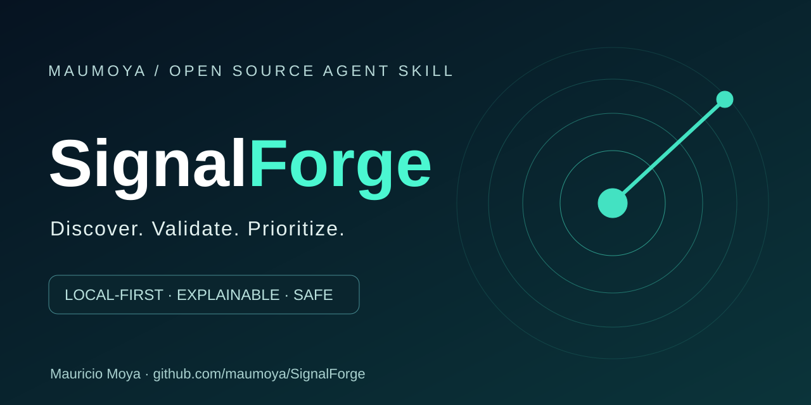
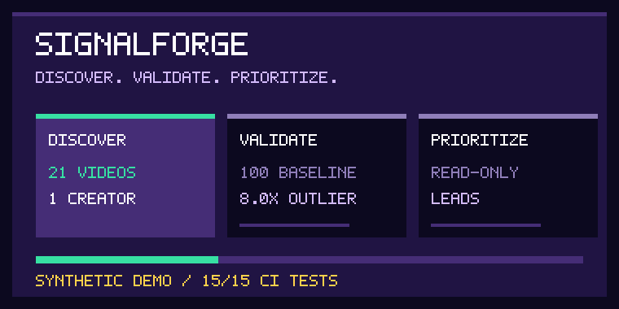
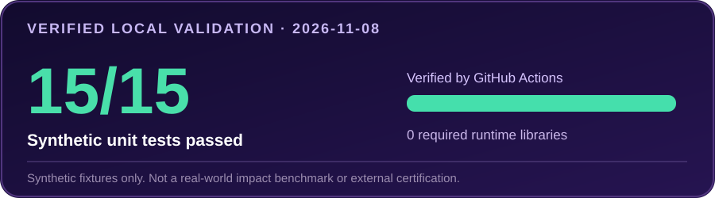

<p align="center">
  
</p>

<p align="center">
  
  <a href="#results-measured-2026-11-08"></a>
  <a href="https://github.com/maumoya/SignalForge/actions/workflows/test.yml"></a>
  
  <a href="https://opensource.org/license/mit"></a>
  <a href="PRIVACY.md"></a>
  <a href="https://scorecard.dev/viewer/?uri=github.com/maumoya/SignalForge"></a>
  
</p>

<p align="center">
  
</p>

<p align="center">
  <a href="#results-measured-2026-11-08"></a>
</p>

# SignalForge

**Spot the signal. Build what matters.** SignalForge is an open-source agent skill and Python CLI that helps researchers, creators and builders identify **unusually strong content signals**, compare them against each creator's normal performance and turn recurring themes into **read-only research leads**.

**The promise:** find what deserves investigation, with inspectable evidence. Not another black-box “viral score.” Not automatic software installation. Not a claim that popularity proves value.

> **Current scope (v0.1 development foundation):** analyzes user-provided JSON metadata **offline**. Native YouTube, Instagram, TikTok and GitHub data collection, longitudinal growth measurements and live VISION integration are **not implemented yet**. The GIF and 8× example use synthetic data.

## Install

**Claude Code plugin:**
```text
/plugin marketplace add maumoya/SignalForge
/plugin install signalforge@signalforge
```

**Agents that read SKILL.md files:**
```bash
npx skills add maumoya/SignalForge
```

**Standalone Python (3.10+, no runtime dependencies):**
```bash
python -m signalforge examples/sample.json
python -m signalforge examples/sample.json --out report.json
python -m signalforge examples/sample.json --candidates --out leads.json
```

The repository is public, but a real Claude Code plugin installation and trigger/ablation benchmark have **not** been recorded yet.

## See the difference

A big creator gets 100,000 views on every post; a small creator typically gets 100. Counting absolute views alone favors the big creator. SignalForge instead calculates:

```text
One creator's normal views:      100  (median of 20 neighboring videos)
Standout video's views:          800
Relative performance:           8.0×
Decision:                       Investigate, don't auto-adopt
```

That 8.0× example is synthetic, verified by the unit test `test_relative_baseline`. It is **not** a real-world growth claim.

| Stage | SignalForge does | Why it matters |
|---|---|---|
| **01 Discover** | Loads authorized public-content metadata from JSON | Independent, inspectable inputs |
| **02 Validate** | Checks URLs and data; deduplicates; compares same-creator neighbor medians | A small creator's outlier can matter |
| **03 Prioritize** | Ranks repeat topics using creator breadth and relative performance | Repeatability matters more than one viral clip |
| **04 Handoff** | Exports versioned `investigate-only` candidates | Other agents can review findings without auto-installing anything |

### Your input

```json
{
  "items": [
    {
      "url": "https://www.youtube.com/",
      "platform": "youtube",
      "creator": "creator-a",
      "title": "Example short",
      "topic": "ai agents",
      "views": 12000,
      "published_at": "2026-11-01T12:00:00Z"
    }
  ]
}
```

Missing dates, creator identities and view counts are reported as gaps, not guessed. At least five neighboring videos from the same creator and platform are required to compute a relative multiplier. No HTTP requests are made by the offline engine.

## Results (measured 2026-11-08)

**What we actually tested:** the Python 3 standard-library core with synthetic video fixtures and adversarial input cases. GitHub Actions tests, lint and CodeQL completed successfully on the initial public implementation. The 15 tests include creator-relative baseline, sparse data, deduplication, public/private URL handling, inert hostile titles, owner approval gates and no-overwrite outputs.

| Check | Observed result | Evidence |
|---|---|---|
| Python unit tests | **15/15 pass** | [GitHub CI](https://github.com/maumoya/SignalForge/actions/workflows/test.yml), [test cases](tests/test_core.py) |
| Required runtime dependencies | **0** | [pyproject.toml](pyproject.toml) |
| Synthetic outlier check | **8.0×**, with 800 views / 100 baseline | [test_relative_baseline](tests/test_core.py) |
| Read-only handoff | **Enabled**; adoption requires approval | [export schema](skills/signalforge/references/integration.md) |
| OpenSSF | **Live report**, not an arbitrary certification | [Scorecard viewer](https://scorecard.dev/viewer/?uri=github.com/maumoya/SignalForge) |
| LLM skill eval / live install | **Not yet executed** | [Validation status](VALIDATION.md) |

**Limitations:** these are local/synthetic checks, not a measured with-vs-without skill benefit, not a performance comparison against other tools and not evidence of real-world viral prediction accuracy. The heuristic topic score is not a probability, forecast, or recommendation to deploy software.

## Security and privacy

The current engine:
- Does **not** connect to YouTube, GitHub or any network; it reads the supplied local JSON.
- Does **not** use browser cookies, private messages, tokens, paid APIs or telemetry.
- Does **not** execute instructions inside captions, titles, repos, links or documents.
- Does **not** install software, overwrite output files or approve its own findings.
- Exports leads for further human/agent research; adoption requires separate gates.

See [SECURITY.md](SECURITY.md), [PRIVACY.md](PRIVACY.md) and the [threat model](skills/signalforge/references/security.md). These boundaries must be reviewed again before adding live collectors.

## Evaluations and development

```bash
python -m unittest discover -s tests -v
bash scripts/lint_skill.sh
```

Three [agent-evaluation scenarios](evals/) are included: relative virality, prompt-injection resistance and owner approval. **Their presence is not proof that an LLM has run or passed them.** `skill-forger-e2e` readiness and `your-authorship-skill` are wired into CI to surface release and ownership checks.

See [release gates](README_RELEASE_GATES.md), [validation](VALIDATION.md), [methodology](skills/signalforge/references/methodology.md), and [read-only integration](skills/signalforge/references/integration.md).

## Frequently asked questions

### Can it discover YouTube or Instagram videos by itself?
Not in v0.1. Feed it metadata you obtained through an authorized source. Live collectors are a planned addition and will need separate security and platform-rule review.

### Does it send my data to an AI model or cloud server?
No. The current Python engine is offline. If you run it through a separate agent, that agent's own privacy and model configuration still apply.

### Is an 8× multiplier a guaranteed viral trend?
No. It is an observed relative outlier in the sample. Platform view definitions, video age, selection bias and missing history matter.

### Can it install a GitHub library or change VISION automatically?
No. SignalForge produces read-only `investigate-only` leads. Any downstream VISION adapter must preserve Reward Radar's independent risk scoring and owner approval.

### Can I use this as a GitHub Action?

Yes. On GitHub CI you can validate a JSON dataset without downloading or running external code:

```yaml
name: Check public signals
on: [pull_request]
permissions: read-all
jobs:
  signals:
    runs-on: ubuntu-latest
    steps:
      - uses: actions/checkout@3d3c42e5aac5ba805825da76410c181273ba90b1
        with:
          persist-credentials: false
      - uses: maumoya/SignalForge@main
        with:
          dataset: examples/sample.json
```

Pin the Action to a verified immutable commit SHA in production. The self-test in CI proves that valid data pass and unsafe-only data fail. GitHub Marketplace listing is a separate publication step.

### Is it security-certified?
No. OpenSSF Scorecard is independently evaluated, but Best Practices and a signed public release have not been completed.

## About the author

**Mauricio Moya** ([@maumoya](https://github.com/maumoya)) combines finance, quantitative analytics, operations and software engineering to build practical systems that turn data into decisions. SignalForge grew from a real need: separate interesting social signals from changes worth investigating and eventually implementing, without weakening the controls of an agent-driven development workflow.

Explore [my portfolio](https://maumoya.github.io/), [Skill Forger E2E](https://github.com/maumoya/skill-forger-e2e), [Your Authorship Skill](https://github.com/maumoya/your-authorship-skill) or [LinkedIn](https://www.linkedin.com/in/mba-mmoyat/).

## License

**MIT**, copyright © 2026 **Mauricio Moya**. See [LICENSE](LICENSE).

The creator-neighbor-median research idea was independently implemented after reviewing a 2026 Spanish-language viral-video methodology guide credited to Pedro. No copyrighted PDF pages, artwork or scripts were republished.
